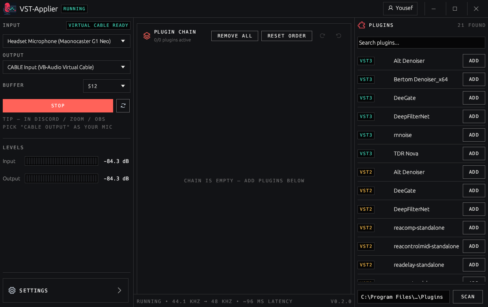
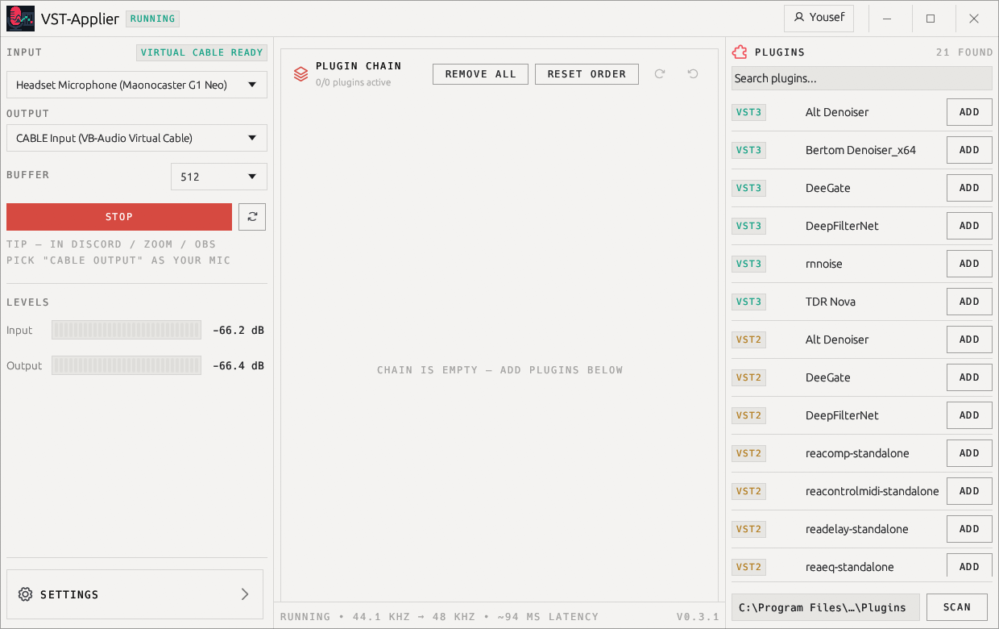

# VST-Applier

**Real-time microphone plugin host for Windows.** Run a VST2/VST3 plugin chain on your microphone and route the result into a virtual audio cable — so Discord, Zoom, OBS and anything else hear the processed voice.

**100% Rust** — engine, UI, and the two VST host DLLs (`Vst2HostNative.dll`, `Vst3HostNative.dll`) are all compiled from crates in this workspace (no C/C++ anywhere).

| Dark (default) | Light |
|---|---|
|  |  |

## Features

- **Real-time VST2 + VST3 chain** on your mic, at low latency (typically ~10–100 ms depending on buffer and devices).
- **Live chain editing** — add, remove, reorder, enable/disable plugins while audio runs, with no cut and no restart.
- **21 plugins bundled** — RNNoise (mono/stereo), DeepFilterNet, Alt Denoiser, Bertom Denoiser, DeeGate, TDR Nova and the REAPER ReaPlugs suite (ReaEQ, ReaGate, ReaComp, …). Scan any folder for more.
- **Settings preserved** — every plugin keeps its knob positions across enable/disable, reorder and restarts. Your chain auto-saves on every exit, including updates.
- **Profiles** — save/load named setups; the active profile (or the live session) is restored at launch.
- **Safe engine** — audio threads are panic-isolated; anti-lag ring buffer; dropout counter; real measured status (latency, sample rates, buffer).
- **Quality of life** — system tray with single-instance wake, start-with-Windows, red/teal status discipline, Dark / Light / **System** themes, folder picker for your plugin directory.
- **Self-updating** — checks GitHub Releases, stages and swaps in place (one admin prompt when needed).

## Install

1. Download **`VST-Applier-Setup-vX.Y.Z.exe`** from [Releases](https://github.com/YousefMohiey/VST-Applier/releases/latest).
2. Run it. The setup bundles everything, including the two native host DLLs and the plugin pack. You can optionally install the **VB-CABLE** virtual audio driver from the same wizard (recommended; it is skipped automatically if you already have it — needs one reboot).
3. Launch **VST-Applier**:
   - pick your **input** (your microphone) and **output** (`CABLE Input (VB-Audio Virtual Cable)`),
   - add plugins from the **PLUGINS** panel,
   - press **START**.
4. In Discord / Zoom / OBS, choose **`CABLE Output (VB-Audio Virtual Cable)`** as your microphone.

A portable zip (`VST-Applier-vX.Y.Z-win64.zip`, app + host DLLs) is attached to every release as well — it is also the payload the in-app updater uses.

## How it works

```
mic ──► WASAPI capture ──► mono ──► VST2/VST3 chain (48 kHz) ──► resample ──► VB-CABLE ──► Discord/Zoom/OBS
```

- Capture and render run on separate streams connected by a lock-free ring buffer with an occupancy servo, so microphone/cable clock drift can never starve or flood the audio.
- Latency depends on the selected buffer (128–4096 samples; 1024 default → snappy UI, stable audio).
- The chain is a single native plugin instance per slot, hosted through `Vst2HostNative.dll` / `Vst3HostNative.dll`.

## Tips

- Want the lowest latency? Drop the buffer; if you hear crackles, raise it.
- Click the plugins-folder chip (bottom-right) to point the app at any VST folder, then hit **SCAN**.
- The status bar at the bottom shows buffer, sample rates and measured latency; hover it for full diagnostics.
- Updates: **SETTINGS → Check now**. Anything that goes wrong during an update is logged to `%APPDATA%\VstApplier\pending\install.log`.

## Building from source

Requirements:

- Rust stable (MSVC toolchain) with `cargo` — that's it. Everything, including
  the two VST host DLLs, builds from this workspace.

```powershell
cargo build --release
# -> target\release\vst-applier.exe
#    target\release\Vst2HostNative.dll
#    target\release\Vst3HostNative.dll
```

### Layout

| Path | What it is |
|---|---|
| `src/` | egui desktop UI, tray, updater, single-instance, theming |
| `crates/audio-engine/` | WASAPI route: capture → chain → resample → cable, lock-free ring |
| `crates/vst-host-sys/` | FFI bindings to the host DLLs, state blobs, plugin calls |
| `crates/vst2-host-dll/` | the VST2 host DLL — 100% Rust cdylib (`Vst2HostNative.dll`) |
| `crates/vst3-host-dll/` | the VST3 host DLL — 100% Rust cdylib (`Vst3HostNative.dll`) |
| `crates/app-state/` | profiles, settings, session persistence, plugin scanning |
| `installer/` | Inno Setup script + staged payload for the setup |
| `examples/` (crate subdirs) | self-check binaries: chain hot-add, plugin verification, profile roundtrip |

### Self-checks

```powershell
cargo run -p audio-engine --example chain_hot_add   # live chain edits on a running route
cargo run -p app-state    --example profile_roundtrip
```

## Third-party

- **[VB-CABLE](https://vb-audio.com/Cable/)** virtual audio driver by VB-Audio — bundled installer, donationware.
- Bundled plugins keep their own licenses: REAPER ReaPlugs (Cockos), RNNoise builds (Xiph/werman), DeepFilterNet, Alt Denoiser, Bertom Denoiser, DeeGate, TDR Nova (Tokyo Dawn Labs).

## Legacy

The original **C# implementation** (WinForms app + earlier native hosts) lives on the [`csharp-legacy`](https://github.com/YousefMohiey/VST-Applier/tree/csharp-legacy) branch and in the v0.1–v0.3 release tags.
